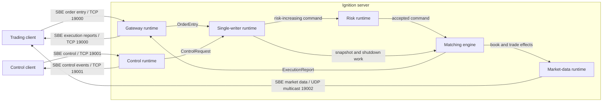
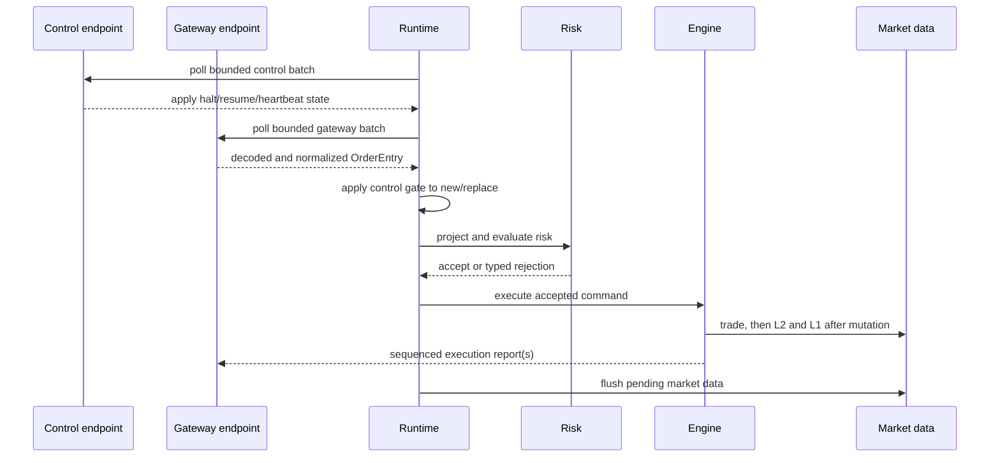

# Architecture

Ignition is a single-process, single-symbol matching service. It separates
transport, protocol, orchestration, policy, matching, and publication so the
matching core remains deterministic and the external adapters can evolve
without changing book semantics.

## Contents

- [Live topology](#live-topology)
- [Components](#component-contracts)
- [Order processing](#order-processing)
- [Runtime modes](#runtime-modes)
- [Determinism and concurrency](#determinism-and-concurrency)
- [Configuration and capacity](#configuration-and-capacity)
- [Extension boundaries](#extension-boundaries)

## Live Topology

Gateway and control have separate listeners, framing state, output rings, and
poll budgets. This prevents gateway connection pressure from consuming the
control endpoint's transport resources. Both are deliberately orchestrated by
one single-writer runtime; control is polled first so an operational state
change is visible before the next gateway batch.

The live TCP adapter accepts one active client per endpoint. Authentication,
account binding, rate limits, multi-session fan-in, and deterministic ordering
across sessions belong in a future upstream session gateway rather than in the
matcher.

## Components

| Component | Owns | Accepts and emits | Deliberately does not own |
| --- | --- | --- | --- |
| `domain` | Protocol-independent IDs, values, commands, events, and reject reasons | Copyable typed values shared by all components | Encoding, I/O, policy, or book state |
| `protocol` | SBE header validation, generated codec integration, and wire/domain conversion | Byte slices ↔ typed domain messages | Transport and business decisions |
| `io` | Framing, TCP/UDP/file/in-memory backends, bounded output, and input recording | Complete frames and borrowed publishers | Message interpretation |
| `gateway` | Trading ingress, normalization, execution-report egress, and gateway metrics boundary | SBE frames → `OrderEntry`; `ExecutionReport` → SBE | Risk and matching policy |
| `control` | Kill-switch state, heartbeat liveness, control acknowledgements, and control ingress | SBE frames → `ControlRequest`; typed control events → SBE | Book mutation and snapshot data ownership |
| `risk` | Price bands, STP, and projected account exposure checks | `OrderEntry` plus read-only engine views → accept/reject | Book mutation or protocol output |
| `engine` | Resting book, lifecycle operations, matching, and book invariants | Normalized `OrderEntry` → reports and book/trade effects | Clock, transport, framing, and risk policy |
| `market_data` | Trade/L1/L2 shaping, feed sequencing, encoding, and UDP/file egress | Typed book/trade effects → SBE feed messages | Matching decisions |
| `runtime` | Component graph, global sequencing, phase order, shutdown, and mode lifecycle | Poll progress and typed component boundaries | Wire layouts and book internals |
| `metrics` | HDR latency samples and benchmark counters | Gateway timing observations → snapshot | Matching state |
| `client` | Interactive commands, display, heartbeat, and optional synthetic traffic | Operator input and external market data ↔ SBE frames | Privileged access to engine internals |

## Order Processing

Cancels and mass cancels bypass the risk-increasing control gate so exposure
can still be reduced while trading is halted. New orders and cancel-replaces
observe control state immediately before risk and matching, not only when bytes
enter the process. Detailed policy is in [Risk and control](risk-and-control.md).

All logical outbound events consume one global `engineSeq`. Market-data events
also consume a feed-local `mdSeq`; trade prints additionally consume a
`tradeId`. State is mutated before its resulting output is sequenced and
published. The [wire protocol](protocol.md) defines the observable ordering and
gap-detection fields.

## Runtime Modes

Live, replay, and benchmark modes all build the same `Runtime` graph. They
differ only at startup-selected leaf adapters:

| Mode | Control input | Gateway input | Output |
| --- | --- | --- | --- |
| Live | Nonblocking TCP, optionally recorded | Nonblocking TCP, optionally recorded | TCP execution/control plus UDP multicast market data |
| Replay | Finite recorded file | Finite recorded file | Fresh control, gateway, and market-data files |
| Benchmark | Disabled | Prepared deterministic in-memory SBE frames | Counted in-memory sinks |

The shared path prevents replay and benchmark traffic from bypassing decode,
normalization, risk, matching, sequencing, or encoding. Replay details are in
[Replay](replay.md); the benchmark boundary is in [`BENCH.md`](../BENCH.md).

## Determinism and Concurrency

The engine has one mutable owner and uses no book locks. Same-price FIFO
priority is defined by the runtime-assigned input order, not by client
timestamps or thread scheduling. Live receive timestamps come from one
process-local monotonic clock. Recording persists both the global input
sequence and receive timestamp; replay injects those recorded values instead
of reading the clock.

No wall-clock value, random value, or unordered iteration enters matching or
output order. Deterministic traversal is explicit for snapshots, mass cancel,
matching, and shutdown.

## Configuration and Capacity

[`configs/server.yaml`](../configs/server.yaml) contains deterministic reference
data, matching capacity, risk policy, heartbeat, and poll budgets. Live-only
addresses, output capacities, multicast settings, and recording selection live
in [`configs/live.yaml`](../configs/live.yaml). Environment overrides are
limited to deployment addresses and client adapter selection.

The runtime allocates bounded book storage and reusable endpoint buffers during
construction. It does not grow these structures in the order-entry path. If a
command would exhaust resting-order or active-page capacity, the command is
rejected before mutation and the runtime drains the book, flushes outputs, and
terminates. TCP output beyond its configured pending-byte limit disconnects the
active session and reports an error; multicast queue exhaustion is surfaced as
a runtime error.

## Extension Boundaries

- Multi-symbol operation can shard instruments across independent single-writer
  runtimes while preserving each symbol's local ordering.
- A session gateway can add authentication, account binding, throttling, and
  deterministic multi-client fan-in ahead of the existing binary boundary.
- Kernel-bypass or FPGA-assisted parsing can replace transport/protocol leaves
  without exposing book internals.
- Persistence can consume ordered input and output logs; a restorable checkpoint
  requires more state than the current inspection snapshot contains.
- Market-data recovery can add a versioned L2 snapshot and delta replay around
  the existing `mdSeq` contract.

The rationale and tradeoffs behind these boundaries are recorded in
[Design decisions](design-decisions.md).
