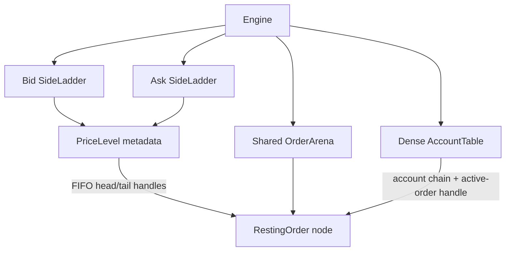

# Matching Engine

The engine owns one in-memory order book for one configured instrument. It
receives normalized, pre-risk `OrderEntry` values, mutates the book through a
single writer, and emits execution reports and market-data effects through
caller-owned publishers. It never reads a clock, parses wire bytes, performs
I/O, or chooses risk policy.

## Contents

- [Matching rules](#matching-rules)
- [Order types and time in force](#order-types-and-time-in-force)
- [Identity, cancel, and mass cancel](#identity-cancel-and-mass-cancel)
- [Cancel-replace priority](#cancel-replace-priority)
- [Reports and event ordering](#reports-and-event-ordering)
- [Book structure](#book-structure)
- [Capacity discipline](#capacity-discipline)
- [Complexity](#complexity)
- [Alternatives considered](#alternatives-considered)
- [Enforced invariants](#enforced-invariants)

## Matching Rules

Ignition uses strict price-time priority:

1. The economically best opposite price executes first.
2. At one price, resting orders execute from FIFO head to tail.
3. Each trade uses the maker's resting price.
4. An aggressive order walks subsequent occupied levels until full, no longer
   price-compatible, or out of liquidity.

Client timestamps do not establish priority. The runtime's serialized input
order determines when an order reaches a FIFO tail, making concurrent external
submission deterministic at the engine boundary.

An incoming buy executes asks priced at or below its limit; an incoming sell
executes bids priced at or above its limit. A market order has no limit. A
locked incoming order therefore trades at the equal resting price, and a
crossing order consumes available liquidity instead of creating a persistently
locked or crossed book.

## Order Types and Time in Force

| Order | Behaviour |
| --- | --- |
| Limit GTC | Walks executable liquidity, then rests any residual at its limit |
| Limit IOC | Walks executable liquidity, then expires any residual |
| Market | Walks all visible opposite liquidity and never rests |
| Limit PostOnly | Rests only when non-crossing; a crossing order is canceled without execution |

In a thin book, market and IOC orders may partially fill. If no quantity fills,
the engine emits `Expired/Expired` with no fill price. If a partial fill leaves
unexecutable residual, the final taker report has `execType=Trade`,
`ordStatus=Expired`, the final fill price and quantity, and
`remainingQty=0`. A partially filled GTC instead keeps its live residual and a
`PartiallyFilled` status.

## Identity, Cancel, and Mass Cancel

A client order ID is unique only within its account while live. The engine
therefore resolves an order with `(accountId, clientOrderId)`. Separate
accounts may use the same numeric client order ID simultaneously, and an
account may reuse an ID after the previous order leaves the book.

`CancelOrder` physically unlinks a resting order from its price FIFO, account
chain, aggregate level, and active-order lookup. Unknown or wrong-account
cancels are rejected as `UnknownOrder`.

`MassCancel` walks only the target account's intrusive active-order chain. It
emits one cancellation report per removed order, followed by a terminal
cancellation report for the mass-cancel command.

## Cancel-Replace Priority

Cancel-replace follows exchange-style queue rules:

| Change | Priority |
| --- | --- |
| Same price and equal quantity | Preserved; no visible market-data mutation |
| Same price and lower quantity | Preserved; level aggregate is reduced |
| Same price and higher quantity | Lost |
| Any price change | Lost |

A priority-preserving replacement updates the existing arena node and active
order key in place. A priority-losing replacement cancels and unlinks the
original, emits its cancellation effects, and re-enters the replacement as a
new GTC limit order. That replacement may execute immediately before any
residual rests.

## Reports and Event Ordering

Execution reports separate the event from the resulting order state:

| `execType` | Typical resulting `ordStatus` |
| --- | --- |
| `New` | `New` |
| `Trade` | `PartiallyFilled`, `Filled`, or terminal `Expired` |
| `Canceled` | `Canceled` |
| `Replaced` | `Replaced` |
| `Rejected` | `Rejected` |
| `Expired` | `Expired` when no execution occurred |

Every fill has exactly one maker and one taker. For a fill, book state is
updated first, then the engine publishes the trade print, absolute L2 state,
the resulting L1 snapshot, the maker report, and the taker report. The final
taker report is delayed just long enough to know whether the order fills,
rests, or expires. All these messages consume the shared global sequence in
publication order.

A passive add mutates the book, publishes L2 and L1, then publishes its `New`
report. Cancel, replace, fill, and mass-cancel outputs likewise describe state
that has already been applied.

## Book Structure

The engine composes four cooperating structures:



### Paged price ladders

Each side addresses a fixed inclusive storage envelope. A price maps through:

```text
price → tick offset → logical page → offset within page → PriceLevel
```

`page_slots` directly maps every logical page to an optional physical page.
Only a bounded number of physical pages exist. Empty logical pages consume no
physical page; activation takes a reset page from a preallocated pool, and an
empty page returns to that pool without allocation.

Two bitmap layers track occupied logical pages and occupied levels within a
page. A cached key stores the current highest bid or lowest ask. Traversal
checks the current page and then uses bit operations to jump to the next
occupied page instead of scanning every tick.

Each `PriceLevel` contains only aggregate quantity, order count, and FIFO head
and tail handles. It does not own order nodes.

### Fixed-capacity order arena

All resting orders live in one preallocated `OrderArena`. Allocation takes an
index from an internal free list; freeing returns it. Handles contain both a
slot index and generation, so a stale handle cannot silently refer to a newer
order that reused the same slot.

Each order node contains two intrusive doubly linked-list memberships:

- price-level links preserve FIFO and allow arbitrary unlink without scanning;
- account links let mass cancel visit only one account's orders.

Physical unlinking keeps future matching work independent of past cancel
volume. Lazy cancellation was rejected because it transfers cleanup into a
later aggressive order and can create unpredictable tail spikes.

### Account state and lookup

Accounts are bounded at startup by `max_account_id`, so account aggregates use
a dense preallocated table indexed by the raw `u32` account ID. Each slot
stores active-chain endpoints, resting-order count, and raw open notional.

A single pre-sized hash map resolves the losslessly packed
`(accountId, clientOrderId)` key to an arena handle. It is shared across
accounts rather than allocating a map for every possible account. The map is
sized to `max_resting_orders`, the maximum number of live lookup entries.

## Capacity Discipline

Before a new order or priority-losing replacement mutates state, a read-only
projection determines whether its residual could need a resting slot or a new
physical page. The projection accounts for slots/pages that the same command
will release through fills or replacement removal.

If capacity is unavailable, no partial mutation occurs. The command is rejected
and the owning runtime initiates the fail-closed drain policy described in
[Risk and control](risk-and-control.md).

## Complexity

Let:

- `F` be maker orders filled;
- `L` be occupied price levels crossed or depleted;
- `A` be live orders for the target account;
- `E` be emitted reports and market-data events;
- `W` be bitmap words examined when a cached best or next level changes.

| Operation | Cost | Why |
| --- | --- | --- |
| Passive limit insertion | Expected `O(1)` | Direct price mapping, free-list arena allocation, hash insertion, FIFO append |
| Cancel | Expected `O(1)` | Hash lookup and intrusive unlink |
| Same-price non-increasing replace | Expected `O(1)` | In-place node and aggregate update |
| Priority-losing replace | Expected `O(1) + matching` | Unlink, re-entry, then any real executions |
| Current best/top read | `O(1)` | Cached best key |
| Best/next occupied discovery | `O(W)` | Packed bitmap traversal, bounded by configured storage |
| Aggressive matching | `O(F + L + E)` | Visits and reports only real executions and occupied levels |
| Mass cancel | `O(A + E)` | Walks only the account chain |
| Snapshot or full drain | Linear in active levels/orders and output | Must visit every represented row/change |

Hash-table access is expected rather than worst-case constant time. Bitmap work
is bounded for a fixed configured book, but its honest variable cost is the
number of machine words examined. Matching cannot be constant independent of
fills because every maker and observable event must be processed.

## Alternatives Considered

### `BTreeMap<Price, PriceLevel>`

This naturally represents sparse ordered prices but introduces `O(log n)`
lookup/insertion, pointer-heavy nodes, and less predictable cache behaviour. It
is a reasonable general-purpose design, but not the chosen bounded
single-instrument latency tradeoff.

### `HashMap<Price, PriceLevel>`

This provides expected constant exact-price lookup but no ordered best-price or
next-level operation. A second ordered index would be required, adding
cross-index mutation and locality costs.

### Fully dense ladder

One level per possible price gives direct lookup and simple traversal, but the
configured BTC-USD price envelope is much wider than typical active depth. The
paged design retains direct logical addressing while bounding committed level
storage by `max_active_pages`.

## Enforced Invariants

Deterministic scenario and property tests enforce that:

- prices and quantities are positive and tick/lot aligned;
- level aggregates equal the sum of their resting orders;
- account counts and open notional agree with the live book;
- non-matching operations conserve unaffected resting quantity;
- price-time priority is never violated;
- each trade has one maker and one taker at the maker price;
- intrusive links, active-order lookup, and arena generations remain coherent;
- execution and market-data sequences are strictly increasing;
- market-data output reflects each generated mutation;
- cancel-replace and mass-cancel affect only the intended orders.

Run the complete suite with `cargo test`. Risk-specific invariants are described
in [Risk and control](risk-and-control.md).
